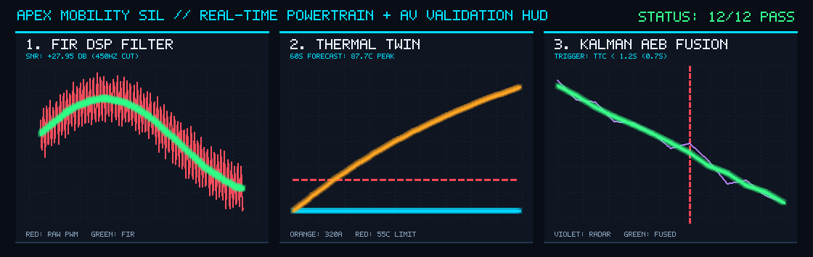
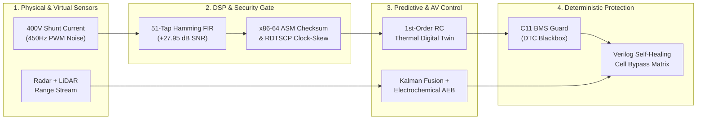

# Apex Mobility SIL

**Deterministic Software-in-the-Loop (SIL) Architecture for Software-Defined EVs & Autonomous Mobility**



**Apex Mobility SIL** is a full-stack, zero-dependency automotive validation platform built natively on Linux. Rather than treating Autonomous Driving (AV) motion planning and Battery Management Systems (BMS) as isolated domains, this architecture couples **electrochemical anode aging physics**, **hardware-level CPU clock-skew intrusion detection**, and **single-cycle Verilog cell-bypass logic** into a deterministic real-time pipeline.

---

## System Architecture & Signal Flow



---

## Core Engineering Innovations

* **Electrochemical-Aware Trajectory & Regen Governor (`/av-perception-fusion/electrochemical_governor.py`)**
  Calculates real-time graphite anode overpotential (\(\eta_{\text{anode}}\)) prior to regenerative braking. Dynamically blends mechanical friction braking with capped regenerative current to prevent lithium plating at high SoC, while enforcing a hard **Safety AEB Override** (`TTC < 1.3s`) for sudden road obstacles.
* **Physical-Layer CAN Intrusion Fingerprinting via `rdtscp` (`/bridges/can-phy-fingerprint/`)**
  Authenticates arriving CAN frames with zero cryptographic payload overhead by measuring nanosecond crystal oscillator drift via x86-64 Assembly (`rdtscp`) paired with ambient thermal compensation (`0.8 ppm/°C`).
* **Self-Healing Verilog Cell-Bypass Matrix (`/plant-models/self-healing-reflex/`)**
  Synthesizable Verilog RTL controller that isolates a single failed battery string in **one clock cycle** to preserve **66% limp-home power** for autonomous shoulder pull-over, while triggering full high-voltage contactor isolation during multi-string or thermal runaway faults.

---

## Verified Benchmark Metrics

| Validation Domain | Implementation Stack | Measured Performance / Guarantee |
| :--- | :--- | :--- |
| **Frame Integrity** | x86-64 Assembly (`nasm`) + C11 | Single-bit corruption detection adhering to System V AMD64 ABI |
| **Bus Intrusion Security** | x86-64 `rdtscp` + Thermal Model | Blocks +85 ppm rogue ECU spoofing while tolerating 48°C crystal drift |
| **Hardware Fault Trip** | Verilog RTL (`iverilog`) | **1-cycle** deterministic contactor isolation & string reconfiguration |
| **Signal Conditioning** | Python Discrete-Time FIR + FFT | **+27.95 dB SNR gain** attenuating 450 Hz PWM inverter switching ripple |
| **Thermal Forecasting** | 1st-Order RC + I²R Digital Twin | **60-second** lookahead early derate prior to 55°C cell threshold |
| **Autonomous Braking** | 1D Kalman Filter (Radar + LiDAR) | Triggers full emergency braking at **TTC < 1.2s** (`t = 0.7s` cut-in) |

---

## Repository Structure

```text
apex-mobility-sil/
├── av-perception-fusion/    # 1D Kalman Radar+LiDAR fusion & electrochemical regen governor
├── bridges/
│   ├── checksum-asm/        # x86-64 assembly rotating XOR telemetry frame validator
│   ├── can-phy-fingerprint/ # x86-64 rdtscp thermal-compensated ECU clock-skew detector
│   └── socketcan-bus/       # Native Linux PF_CAN (vcan0) C transmitter & Python listener
├── ecu-powertrain-c/        # Embedded C11 BMS thermal/voltage fault guard & DTC logger
├── plant-models/
│   ├── safety-fsm-verilog/  # Synthesizable Verilog HV contactor safety interlock FSM
│   ├── self-healing-reflex/ # Synthesizable Verilog 3-string cell bypass & limp-home matrix
│   └── thermal-twin/        # Physics-informed RC + Joule heating core temperature predictor
├── scenarios/
│   └── edge-case-stress/    # Multi-domain boundary & fault-injection regression suite
├── scripts/
│   ├── sil_cockpit.py       # Live ANSI terminal telemetry & latency benchmark cockpit
│   └── run_sil_pipeline.py  # Master 12-layer CI/CD validation runner
└── telemetry/
    ├── dsp-filter/          # Hamming-windowed FIR low-pass filter & FFT spectral analyzer
    └── logger/              # Deterministic JSON/CSV flight recorder & HUD plot generator
```

---

## Quick Start (Ubuntu / Linux)

```bash
# 1. Install systems, HDL, and numerical toolchains
sudo apt update && sudo apt install -y gcc nasm make iverilog python3-numpy can-utils

# 2. Launch the Live ANSI Telemetry & Latency Cockpit
python3 scripts/sil_cockpit.py

# 3. Execute the Full 12-Layer CI Regression Suite
python3 scripts/run_sil_pipeline.py
```
